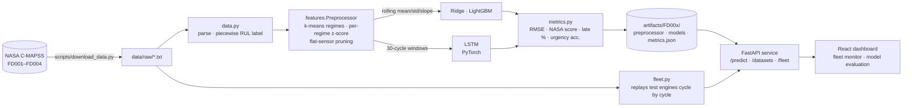

# AeroPredict

**Remaining-useful-life (RUL) prediction for turbofan engines** on NASA's C-MAPSS benchmark — a regime-aware feature pipeline, three models (linear → gradient boosting → LSTM) scored with the field's asymmetric cost function, served as a FastAPI service with a fleet-monitoring dashboard.

[](https://github.com/jaimeet14/aeropredict/actions/workflows/ci.yml)


## Why this project

Predictive maintenance is where ML meets aviation engineering: airlines and engine OEMs (GE Aerospace, Rolls-Royce, Pratt & Whitney) run exactly this problem in production — *given the sensor history of an engine, how many flight cycles are left before it needs to come off the wing?* C-MAPSS is the public benchmark the field uses for it, and it has a few properties that make it a good test of whether you actually understand the problem rather than just fitting a curve:

- **Sensor readings only mean something relative to the flight condition.** Two of the four sub-datasets cycle through six operating regimes (altitude / Mach / throttle); the same raw temperature reading is "healthy" in one regime and "worn" in another. The pipeline detects regimes and standardises per regime.
- **Several sensors are dead weight.** Seven of the 21 are constant or quantised noise. They are pruned by a data-driven rule, not a hard-coded list, so the decision is reproducible and auditable.
- **The right metric is asymmetric.** Predicting more life than an engine has (a *late* prediction) means maintenance is scheduled after the failure. The PHM08 scoring function penalises late errors exponentially harder than early ones; RMSE cannot tell the two apart. Both are reported, and the dashboard shows late errors in red.
- **The target itself needs thought.** Nothing in the sensors can distinguish "300 cycles left" from "150 cycles left" — the engine isn't degrading yet. The standard piecewise-linear target caps RUL at 125; results against both capped and uncapped truth are kept so the effect is visible rather than hidden.

It's the third project in a set with [AeroCommerce](https://github.com/jaimeet14/aerocommerce) (event-driven services + agentic AI) and AeroQuant (quant finance), and deliberately the one with real industrial sensor data behind it.

## Results

Official test split, one prediction per engine at its last observed cycle, against `RUL_FD00x.txt` (capped at 125; lower is better everywhere; best NASA score per subset in bold). Regenerate with `python scripts/results_table.py`.

| Subset | Regimes | Sensors dropped | Model | RMSE | MAE | NASA score | Late % | Urgency acc. |
| --- | --- | --- | --- | ---: | ---: | ---: | ---: | ---: |
| **FD001** | 1 | s1, s5, s6, s10, s16, s18, s19 | Ridge (linear) | 18.14 | 14.38 | 553 | 53% | 84% |
|  | |  | **LightGBM** | 11.98 | 8.69 | 210 | 59% | 90% |
|  | |  | LSTM | 13.53 | 10.08 | 260 | 56% | 91% |
| **FD002** | 6 | s1, s5, s10, s16, s18, s19 | Ridge (linear) | 18.35 | 15.25 | 1500 | 47% | 79% |
|  | |  | **LightGBM** | 12.74 | 9.14 | 715 | 42% | 94% |
|  | |  | LSTM | 13.91 | 10.64 | 1015 | 39% | 94% |
| **FD003** | 1 | s1, s5, s16, s18, s19 | Ridge (linear) | 18.07 | 14.15 | 751 | 57% | 88% |
|  | |  | **LightGBM** | 12.08 | 8.55 | 246 | 59% | 95% |
|  | |  | LSTM | 14.68 | 10.79 | 666 | 59% | 91% |
| **FD004** | 6 | s1, s5, s16, s18, s19 | Ridge (linear) | 21.92 | 17.26 | 2846 | 50% | 78% |
|  | |  | **LightGBM** | 13.10 | 8.78 | 780 | 47% | 92% |
|  | |  | LSTM | 14.80 | 10.85 | 1169 | 47% | 91% |

What the table says, honestly:

- **Gradient boosting on engineered rolling features beats the LSTM on every subset**, on both metrics. With ~100–250 training engines the hand-built trend/statistics features (rolling mean, std and least-squares slope over 30 cycles) give the tree model most of what a sequence model has to discover from scratch. The LSTM is a real, early-stopped model with a unit-level hold-out — it just isn't the winner here, and pretending otherwise would be the wrong lesson.
- **The linear baseline is the sanity floor.** Always predicting the mean test RUL scores RMSE ≈ 40 on every subset; Ridge cuts that by more than half, and the two non-linear models take another third off. Ridge's NASA score is 3–4× worse than LightGBM's even though its RMSE is only ~50% worse — the asymmetric metric is far more sensitive to the tail of late predictions.
- **The multi-regime subsets (FD002/FD004) are harder** — RMSE is close, but the NASA score is 3× worse because there are 2.5× more test engines *and* the late tail is fatter. Per-regime normalisation is what makes them tractable at all; without it a sensor's regime offset swamps its degradation trend.
- **Late fraction hovers around 50%** for every model. Nothing in the training objective (MSE) pushes predictions early; an asymmetric loss would trade RMSE for a lower NASA score. That is the obvious next experiment and it's left visible rather than quietly tuned.
- **Urgency accuracy** is the classification framing: did we put the engine in the right maintenance bucket (`critical ≤ 20`, `warning ≤ 50`, `healthy`)? 90–95% for the two non-linear models.

For reference, published deep-learning results on this benchmark typically report RMSE in the 12–16 range on FD001/FD003 and 14–25 on FD002/FD004, so these numbers are competitive without being a leaderboard chase.

## Architecture



- **`aeropredict/data.py`** — parses the whitespace files, labels run-to-failure trajectories with `rul_true` and the capped `rul`, and validates that `RUL_FD00x.txt` lines up with the test units.
- **`aeropredict/features.py`** — the `Preprocessor`: k-means on the three operating settings (k = 1 or 6 per the dataset readme), per-regime mean/std for every sensor, flat-sensor pruning (`std < 1e-3` *or* ≤ 2 distinct values in every regime), backward-only rolling features, and sliding windows for the sequence model. Rolling slope is computed with rolling sums in O(n) rather than a per-row polyfit.
- **`aeropredict/models/`** — `LinearRUL` (Ridge), `LightGBMRUL`, `LSTMRUL` (2-layer LSTM, unit-level validation split, early stopping, gradient clipping, ReduceLROnPlateau). All clip predictions to `[0, cap]`. `registry.py` saves/loads a per-dataset bundle.
- **`aeropredict/metrics.py`** — RMSE, MAE, the PHM08 asymmetric score, late fraction, and urgency-bucket accuracy.
- **`aeropredict/fleet.py`** — the simulator behind the dashboard: picks a dozen test engines stratified across low/mid/high remaining life, reveals one cycle per tick, re-predicts, and compares to the true RUL (known for test units from the truncation-point label). Engines that reach the end of their recorded data are "returned from the shop" so the fleet keeps moving.
- **`aeropredict/api/`** — FastAPI with Pydantic validation (21 sensors, 3 settings, strictly increasing cycles), CORS for the dashboard, lazy fleet initialisation and optional auto-download of the data.
- **`frontend/`** — React 18 + TypeScript + Recharts. *Fleet Monitor*: urgency tiles, sortable engine table with RUL bars and late/early error colouring, per-engine predicted-vs-true chart and normalised sensor traces. *Model Evaluation*: the results table above, capped/uncapped toggle, NASA-score and RMSE bar charts, LightGBM feature importances.

See [`docs/architecture.md`](docs/architecture.md) for the request flows and [`docs/modeling.md`](docs/modeling.md) for the modelling decisions in more depth.

## Tech stack

| Layer | Choice |
| --- | --- |
| Data / features | pandas, NumPy, scikit-learn (`KMeans`, `Ridge`) |
| Models | LightGBM, PyTorch (LSTM) |
| Serving | FastAPI, Pydantic v2, uvicorn |
| Frontend | React 18, TypeScript, Vite, Recharts |
| Testing | pytest — 32 tests on a synthetic C-MAPSS-shaped dataset, runs offline in ~10 s |
| CI/CD | GitHub Actions — backend tests + API smoke test against committed artifacts, frontend type-check + build, compose validation |
| Infra | Docker Compose (API + nginx-served frontend), CPU-only torch image |

Trained artifacts for all four subsets (~8 MB) are committed, so the API is demoable immediately after `docker compose up` — no training step, no API keys. The raw dataset (12 MB zip) is downloaded on demand and git-ignored.

## Quickstart

### With Docker

```bash
docker compose up --build
```

| Service | URL |
| --- | --- |
| Dashboard | http://localhost:5173 |
| API docs (Swagger) | http://localhost:8010/docs |

The first `/fleet` request downloads the NASA data into `./data` (one-off, ~12 MB).

### Without Docker

```bash
python -m venv .venv && . .venv/bin/activate        # Windows: .venv\Scripts\activate
pip install torch --index-url https://download.pytorch.org/whl/cpu   # or a CUDA wheel if you have a GPU
pip install -r requirements.txt -e .

python scripts/download_data.py                     # NASA C-MAPSS -> data/raw
python scripts/train.py --dataset FD001             # ~1 min on CPU; --dataset all for every subset
uvicorn aeropredict.api.main:app --port 8010

cd frontend && npm install && npm run dev           # http://localhost:5173
```

### Calling the API

```bash
curl -s -X POST http://localhost:8010/predict -H 'content-type: application/json' -d '{
  "dataset": "FD001",
  "model": "lgbm",
  "readings": [
    {"cycle": 1, "settings": [-0.0007, -0.0004, 100.0],
     "sensors": [518.67, 641.82, 1589.70, 1400.60, 14.62, 21.61, 554.36, 2388.06, 9046.19, 1.30,
                 47.47, 521.66, 2388.02, 8138.62, 8.4195, 0.03, 392, 2388, 100.0, 39.06, 23.419]}
  ]
}'
# -> {"dataset":"FD001","model":"lgbm","rul":120.31,"rul_cap":125,"urgency":"healthy",
#     "n_readings":1,"last_cycle":1,"window":30,"note":"Only 1 reading supplied; ... padded ..."}
```

Send the engine's full history (chronological, one object per cycle) for a real prediction; anything shorter than the 30-cycle window is padded and flagged in `note`.

## Testing

```bash
python -m pytest
```

The suite builds a synthetic dataset with the same shape as C-MAPSS (two regimes, flat and quantised sensors, wear-driven drift) and trains a tiny bundle on it, so it needs no download and finishes in about ten seconds. It covers:

- the piecewise-linear RUL label and the cap,
- flat/quantised sensor pruning and regime recovery from the operating settings,
- per-regime standardisation (mean 0 / std 1 within every regime),
- **no forward leakage** — perturbing every cycle after *t* leaves all features at or before *t* bit-identical,
- window shapes, padding of short histories, and last-window selection,
- the NASA score's asymmetry (same absolute error, late costs more) and exponential growth,
- save/load round-trip of every model with identical predictions,
- every API route including validation failures and the fleet simulation (truth counts down one per tick; engines loop back into service).

## Project structure

```
aeropredict/
├── aeropredict/
│   ├── config.py            paths, constants (RUL cap, window, urgency thresholds)
│   ├── data.py              parsing + RUL labelling
│   ├── download.py          NASA mirror download (nested zip)
│   ├── features.py          Preprocessor: regimes, normalisation, pruning, rolling features, windows
│   ├── metrics.py           RMSE, MAE, NASA score, late fraction, urgency accuracy
│   ├── train.py             train + evaluate one subset -> Bundle
│   ├── fleet.py             fleet simulator for the dashboard
│   ├── models/              baseline.py (Ridge, LightGBM) · sequence.py (LSTM) · registry.py
│   └── api/                 FastAPI app + Pydantic schemas
├── scripts/                 download_data.py · train.py · results_table.py
├── tests/                   32 pytest tests, synthetic data, offline
├── artifacts/FD00x/         committed trained bundles + metrics.json
├── frontend/                React + TypeScript dashboard
├── docs/                    architecture.md · modeling.md
├── Dockerfile · docker-compose.yml · Makefile
└── .github/workflows/ci.yml
```

## Honesty notes

- **C-MAPSS is simulated.** NASA generated it with a thermodynamic engine model plus injected faults and noise. It is the right dataset for exercising a correct pipeline and comparing models; it is not evidence about any real aircraft.
- **The models were selected on the official test split** (there is no separate leaderboard hold-out here). The LSTM's early stopping uses a slice of *training* engines, but hyperparameters for all three models were chosen once and not tuned against the test numbers.
- **No look-ahead.** Train and test engines are disjoint units by construction; the leakage risk in this dataset is features that peek forward within a trajectory, and that is what the leakage test pins down.
- **Scoring against capped truth is the convention**, and it flatters every model a little. The `--uncapped` table (and the dashboard toggle) shows the difference: FD001 LightGBM goes from RMSE 11.98 to 13.26.

## License

MIT — see [LICENSE](LICENSE). The C-MAPSS dataset is published by NASA's Prognostics Center of Excellence (Saxena & Goebel, 2008) and is free to use.
