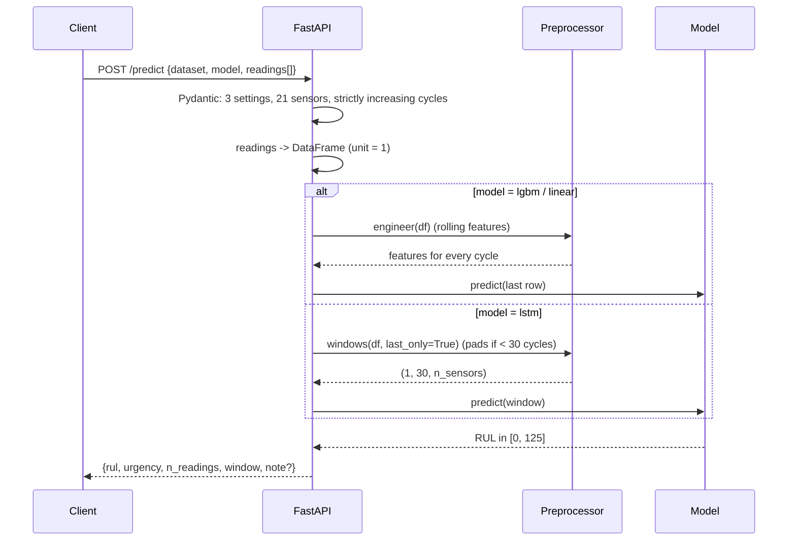
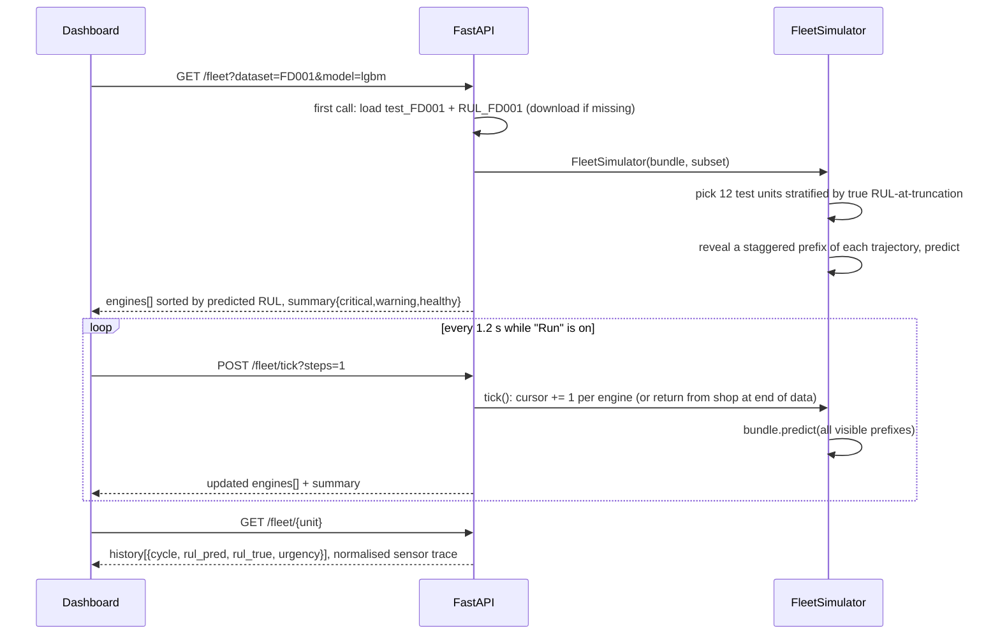
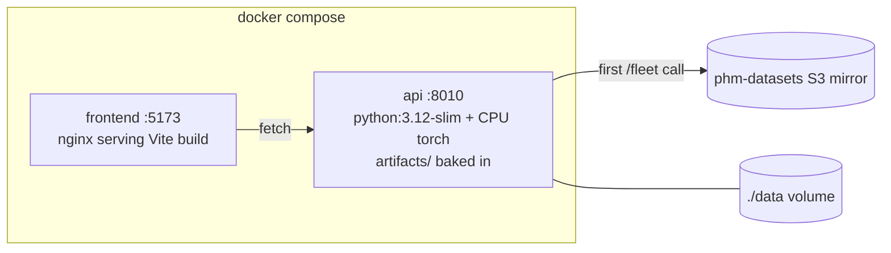

# Architecture

## Training pipeline

```mermaid
flowchart TD
    A[train_FD00x.txt] --> B[add_rul: rul_true = max_cycle - cycle<br/>rul = min(rul_true, 125)]
    B --> C[Preprocessor.fit]
    C --> C1[k-means on setting_1..3<br/>k = 1 for FD001/FD003, 6 for FD002/FD004]
    C --> C2[per-regime mean / std for all 21 sensors]
    C --> C3[flat-sensor rule:<br/>std < 1e-3 OR nunique ≤ 2 in every regime]
    C1 & C2 & C3 --> D{fitted preprocessor}
    D -->|engineer| E[per kept sensor:<br/>value · rolling mean · rolling std · rolling slope<br/>+ cycle + regime]
    D -->|windows| F[(n, 30, n_sensors) tensors<br/>label = rul at window end]
    E --> G[Ridge] & H[LightGBM]
    F --> I[LSTM<br/>10% of units held out · early stopping]
    G & H & I --> J[evaluate on test_FD00x last cycle vs RUL_FD00x]
    J --> K[artifacts/FD00x/]
```

All rolling statistics are computed with `groupby("unit").rolling(window, min_periods=…)`, i.e. they only ever see *earlier* cycles of the *same* engine. `tests/test_features.py::test_engineered_features_do_not_look_forward` perturbs every cycle after *t* and asserts that features at or before *t* are unchanged.

## Request flow: `POST /predict`



## Request flow: fleet simulation



The true RUL at any revealed cycle is `rul_at_truncation + (last_recorded_cycle - cycle)`, which is why the dashboard can draw the grey truth line for test engines even though the test files are truncated.

## Deployment



Environment variables:

| Variable | Default | Purpose |
| --- | --- | --- |
| `AEROPREDICT_DATA_DIR` | `data/raw` | where the NASA text files live |
| `AEROPREDICT_ARTIFACT_DIR` | `artifacts` | trained bundles |
| `AEROPREDICT_AUTO_DOWNLOAD` | `1` | download C-MAPSS on first fleet request |
| `AEROPREDICT_RUL_CAP` | `125` | piecewise-linear cap (training only) |
| `AEROPREDICT_WINDOW` | `30` | rolling / sequence window (training only) |
| `CORS_ORIGINS` | `http://localhost:5173` | comma-separated allowed origins |
| `VITE_API_URL` (frontend) | `http://localhost:8010` | API base URL baked into the build |
